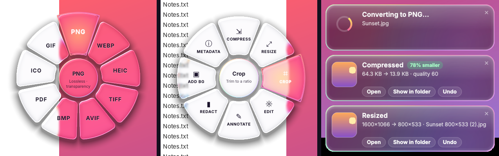

# DragShift

Convert and edit files on **Windows** with a liquid-glass radial menu. Start dragging any file, press **Shift**, and drop it on a slice.



## Install

**Easiest (from source, one click):** download this repo, unzip it, and double-click **`Install-DragShift.bat`**. It installs Python and Inno Setup if missing (via winget), builds the app, and opens **DragShift-Setup.exe** for you. The first run takes a few minutes. It leaves a standalone **`release\DragShift-Setup.exe`** that needs no Python and can be copied to any Windows 10/11 PC.

**Or from a release:** open the [latest release](../../releases/latest) and download:

- **DragShift-Setup.exe** (recommended): installs for your user only, so no admin rights are needed. It adds a Start menu entry, an option to start with Windows, a right-click **DragShift…** entry and a **Send to → DragShift** entry. It uninstalls cleanly from Settings → Apps.
- **DragShift.exe**: a portable version you can run from anywhere.

> **First launch:** SmartScreen may warn because the app isn't code-signed yet. Click **More info → Run anyway**.

## How to use

1. Start dragging a file (an image, PDF, Word or text file; desktop shortcuts to one work too) in File Explorer or on the desktop.
2. Press **Shift**. The menu opens under your cursor.
3. Drop the file on a slice. The result is saved **next to the original**, and the original is never changed.
4. To switch between **Convert** and **Tools**, tap **Shift** again.

Each action ends with a notification that shows what changed, for example *"2.4 MB → 610 KB · 75% smaller"* or *"2400×1600 → 1200×800"*, with **Open**, **Show in folder** and **Undo**. Undo moves the new file to the Recycle Bin.

You can also right-click a file → **DragShift…**, use **Send to → DragShift**, or double-click the tray icon to pick a file.

## What it does

| File | Convert to | Tools |
|---|---|---|
| Images (JPG, PNG, WEBP, HEIC, AVIF, TIFF, BMP, GIF, ICO) | Any of those, or PDF. Several images become one combined PDF | **Compress** (by quality or to a target size such as "under 500 KB", with a before/after preview, several files at once) · **Resize** · **Crop** (ratios, live pixel size, rotate) · **Edit** (Auto, light/colour, rotate, flip, B&W, hold to compare) · **Annotate** (arrows, boxes, numbered steps, text, marker) · **Redact** · **Add BG** · **Metadata** (camera, date, GPS location with a map link; remove location only or remove everything) |
| PDF | JPG or PNG (one per page), DOCX, TXT | Compress · Split · Rotate · Merge (drop several) · **Protect** (AES-256 password) · **Extract images** · Metadata |
| Word (.docx) | PDF (uses Microsoft Word if it's installed, otherwise a built-in renderer), TXT | — |
| Text (.txt, .md, .csv…) | PDF, DOCX | — |

**Settings** (tray menu): trigger key (Shift, Ctrl or Alt), where results go (next to the original or a `DragShift` subfolder), JPG/WebP quality, PDF → image resolution, and start at login.

## The look

The menu, notifications and windows use real **liquid-glass** rendering. DragShift captures the screen behind each surface and refracts it through the shape. A curved edge bends light, R, G and B bend by slightly different amounts (which gives the rainbow fringe), a highlight runs along the rim facing the light, and the tint adapts to what's behind it so text stays readable. The menu renders on a background thread while it pops in, so it still opens instantly.

## Tested on real desktops

Every push runs these jobs on GitHub's Windows machines:

- **Build:** unit tests, the portable exe and installer builds, a self-test of each build, and a silent install → run → uninstall check.
- **End-to-end:** a script moves the real mouse to drag files from File Explorer *and* the Desktop, presses Shift, drops on every conversion and tool, drives each tool window, and checks every output file (format, dimensions, page counts, encryption, metadata removed). The results table and a screen recording are saved to the `e2e-output` branch.
- **Demo video:** pushing to the `demo` branch records a showcase video.

## License

[MIT](LICENSE): free to use, modify and share.

## Run from source

```bat
pip install -r requirements.txt
python -m dragshift
```

Tests: `python -m pytest -q`. Logs are written to `%LOCALAPPDATA%\DragShift\log.txt`.

Windows builds will be code-signed by the SignPath Foundation, which provides free code signing for open-source projects.
